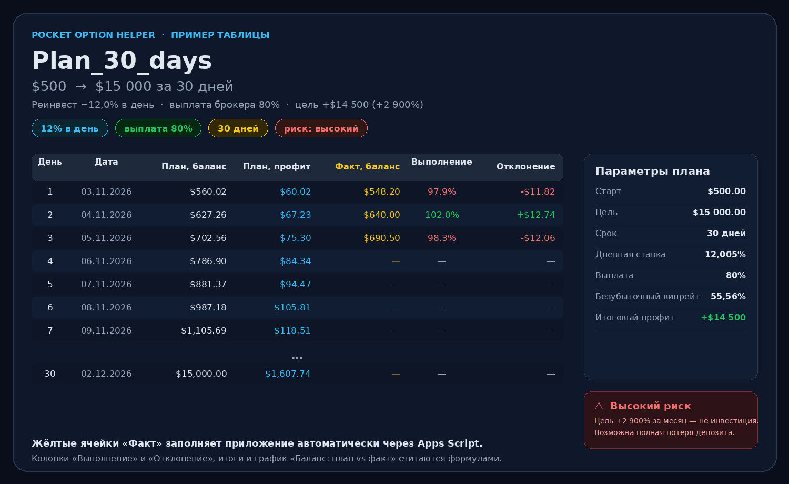
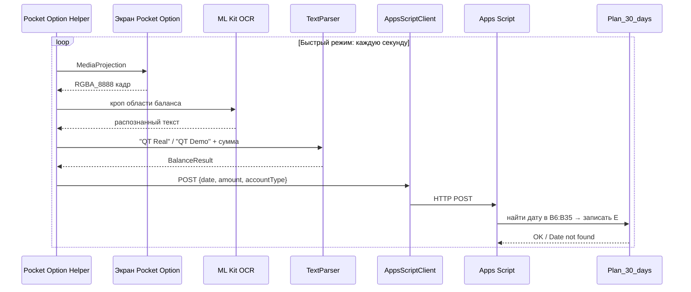

<div align="center">

# 🎯 Pocket Option Helper

**Баланс сам переезжает в Google Таблицу — пока ты торгуешь.**


[📥 Скачать APK](https://github.com/Lumus-0x/PocketOption_Helper/releases/latest) · [✈️ Telegram](https://t.me/lumi_ouroboros) · [💻 GitHub](https://github.com/Lumus-0x/PocketOption_Helper) · [📊 Шаблон таблицы](Plan_30_days.xlsx)

</div>

---

> [!WARNING]
> **Это не инвестиционный совет.** Бинарные опционы — очень рискованный инструмент. Цель «+2 900% за месяц» из примера таблицы — это математическое упражнение, а не обещание доходности. Возможна полная потеря депозита. Не рискуйте деньгами, которые не готовы потерять.

---

## 👋 Сначала — по-человечески

Представь: ты открыл сделку, экран Pocket Option показывает новый баланс, а через пару секунд эта цифра уже стоит в твоей Google Таблице. Не нужно переписывать вручную, держать блокнот рядом или вспоминать, сколько было вчера.

**Pocket Option Helper** — маленькое Android-приложение, которое:

1. смотрит на верхний правый угол Pocket Option;
2. распознаёт `QT Real USD` или `QT Demo USD`;
3. вытаскивает сумму баланса;
4. отправляет её в Apps Script;
5. Apps Script кладёт сумму в нужную строку таблицы.

Всё распознавание происходит **на телефоне**. В облако уходит только число, дата и тип аккаунта.

### Было → Стало

| 😩 Было | 😎 Стало |
|---|---|
| Вручную переписывать баланс после каждой сделки | Баланс появляется в таблице сам |
| Забыл записать — потерял день статистики | История последних 25 записей всегда под рукой |
| Непонятно, идёшь ты по плану или нет | Таблица сама считает профит, выполнение и отклонение |
| Надо смотреть на график и гадать | График «план vs факт» строится автоматически |

### Что умеет

| Возможность | Зачем это тебе |
|---|---|
| 🎥 **Фоновый захват экрана** | Работает, пока открыт Pocket Option |
| 🔍 **OCR на устройстве** | ML Kit распознаёт баланс локально, без облака |
| ⚡ **Быстрый режим** | Проверка каждую секунду, запись — только когда сумма изменилась |
| 🐢 **Обычный режим** | Проверка раз в 10 секунд, запись раз в минуту — для экономии батареи |
| 📊 **Apps Script** | Простой HTTP POST без OAuth и Google Sign-In |
| 🕘 **История 25 записей** | Локальный журнал успешных синхронизаций |
| 🔔 **Тихое уведомление** | Видно, что мониторинг работает, но ничего не вибрирует |
| 📱 **Android 8+** | Поддержка старых и новых устройств |

### Кому подойдёт

- Тем, кто ведёт дневник баланса и хочет автоматизировать рутину.
- Тем, кто торгует по 30-дневному плану и хочет видеть «план vs факт».
- Тем, кто не хочет отдавать экран и баланс сторонним облачным сервисам.

---

## 📊 Пример таблицы: `Plan_30_days.xlsx`

В репозитории лежит готовый шаблон: **[Plan_30_days.xlsx](Plan_30_days.xlsx)**.



### Что внутри

| Лист | Что там |
|---|---|
| **`Plan_30_days`** | 30 дней плана: даты, плановый баланс, плановый профит, факт, выполнение, отклонение |
| **`Параметры`** | Стартовый депозит, цель, срок, дневная ставка, выплата брокера и блок рисков |

Особенности шаблона:

- 🟡 **Жёлтые ячейки `E6:E35`** — сюда приложение записывает факт баланса на конец дня.
- 🧮 **`F`, `G`, `H`** — формулы: факт-профит, выполнение плана и отклонение.
- 📈 **График «Баланс: план vs факт»** — сам обновляется после заполнения `E`.
- ❄️ **Замороженная шапка** — строки 1–5 не уезжают при прокрутке.
- 🚦 **Условное форматирование** — выполнение ≥ 100% зелёное, < 100% красное.

### Параметры плана

| Параметр | Где | Значение в шаблоне |
|---|---|---:|
| Стартовый депозит | `Параметры!B3` | **$500** |
| Цель | `Параметры!B4` | **$15 000** |
| Срок | `Параметры!B5` | **30 дней** |
| Дата старта | `Параметры!B6` | **02.11.2026** |
| Дневная ставка (сложный %) | `Параметры!B9` | **12,0049%** |
| Выплата брокера | `Параметры!B10` | **80%** |
| Безубыточный винрейт | `Параметры!B11` | **55,56%** |
| Итоговый профит по плану | `Plan_30_days!D37` | **$14 500** |

> 💡 **Как менять план:** открой лист `Параметры` и поменяй `B3` (старт), `B4` (цель), `B5` (дней) и `B6` (дата старта). Даты и плановые суммы на листе `Plan_30_days` пересчитаются сами.

### Как читать колонки

| Колонка | Название | Кто заполняет |
|---|---|---|
| `A` | День | Формула/шаблон |
| `B` | Дата | Формула от `Параметры!B6` |
| `C` | План, баланс | Формула сложного процента |
| `D` | План, профит | Формула: `C — предыдущий C` |
| `E` | **Факт, баланс** | 🟡 **Приложение через Apps Script** |
| `F` | Факт, профит | Формула: `E — предыдущий E` |
| `G` | Выполнение | Формула: `E / C` |
| `H` | Отклонение | Формула: `E — C` |

### Формулы, если хочется понять

```text
C6  = C5 * (1 + Параметры!$B$9)      # плановый баланс
D6  = C6 - C5                        # плановый профит
F6  = E6 - E5                        # фактический профит
G6  = E6 / C6                        # выполнение плана
H6  = E6 - C6                        # отклонение от плана
D37 = SUM(D6:D35)                    # итоговый плановый профит
C38 = MAX(0, цель - последний факт)  # сколько осталось до цели
```

Формулы `F`, `G`, `H` начинают считаться только после того, как в `E` появится факт баланса. Пустые строки не ломают итоги.

### Первые 7 дней

| День | Дата | План, баланс | План, профит | Факт (заполняет приложение) |
|---:|:---:|---:|---:|:---:|
| 1 | 03.11.2026 | $560.02 | $60.02 | — |
| 2 | 04.11.2026 | $627.26 | $67.23 | — |
| 3 | 05.11.2026 | $702.56 | $75.30 | — |
| 4 | 06.11.2026 | $786.90 | $84.34 | — |
| 5 | 07.11.2026 | $881.37 | $94.47 | — |
| 6 | 08.11.2026 | $987.18 | $105.81 | — |
| 7 | 09.11.2026 | $1,105.69 | $118.51 | — |

<details>
<summary><b>Показать весь 30-дневный план</b></summary>

| День | Дата | План, баланс | План, профит | Факт (заполняет приложение) |
|---:|:---:|---:|---:|:---:|
| 1 | 03.11.2026 | $560.02 | $60.02 | — |
| 2 | 04.11.2026 | $627.26 | $67.23 | — |
| 3 | 05.11.2026 | $702.56 | $75.30 | — |
| 4 | 06.11.2026 | $786.90 | $84.34 | — |
| 5 | 07.11.2026 | $881.37 | $94.47 | — |
| 6 | 08.11.2026 | $987.18 | $105.81 | — |
| 7 | 09.11.2026 | $1,105.69 | $118.51 | — |
| 8 | 10.11.2026 | $1,238.42 | $132.74 | — |
| 9 | 11.11.2026 | $1,387.10 | $148.67 | — |
| 10 | 12.11.2026 | $1,553.62 | $166.52 | — |
| 11 | 13.11.2026 | $1,740.13 | $186.51 | — |
| 12 | 14.11.2026 | $1,949.03 | $208.90 | — |
| 13 | 15.11.2026 | $2,183.01 | $233.98 | — |
| 14 | 16.11.2026 | $2,445.08 | $262.07 | — |
| 15 | 17.11.2026 | $2,738.61 | $293.53 | — |
| 16 | 18.11.2026 | $3,067.38 | $328.77 | — |
| 17 | 19.11.2026 | $3,435.62 | $368.24 | — |
| 18 | 20.11.2026 | $3,848.07 | $412.45 | — |
| 19 | 21.11.2026 | $4,310.03 | $461.96 | — |
| 20 | 22.11.2026 | $4,827.45 | $517.42 | — |
| 21 | 23.11.2026 | $5,406.98 | $579.53 | — |
| 22 | 24.11.2026 | $6,056.09 | $649.11 | — |
| 23 | 25.11.2026 | $6,783.12 | $727.03 | — |
| 24 | 26.11.2026 | $7,597.44 | $814.31 | — |
| 25 | 27.11.2026 | $8,509.51 | $912.07 | — |
| 26 | 28.11.2026 | $9,531.07 | $1,021.57 | — |
| 27 | 29.11.2026 | $10,675.28 | $1,144.20 | — |
| 28 | 30.11.2026 | $11,956.84 | $1,281.57 | — |
| 29 | 01.12.2026 | $13,392.26 | $1,435.42 | — |
| 30 | 02.12.2026 | $15,000.00 | $1,607.74 | — |

</details>

### ⚠️ Риск, который заложен в шаблоне

> **Цель +2 900% за месяц — крайне высокий риск.**
> При выплате 80% безубыточный винрейт — 55,6%. Для +12% в день нужно ~69–72% побед стабильно.
> Бинарные опционы — не инвестиция. Возможна полная потеря депозита. Не рискуйте деньгами, которые не готовы потерять.

### Как приложение заполняет эту таблицу



**Важно:** приложение пишет только баланс. Даты в колонке `B` должны совпадать с сегодняшним днём. Если сегодняшней даты нет в `B6:B35`, Apps Script вернёт `Date not found`, и запись не произойдёт.

---

## 🚀 Быстрый старт для людей

### Шаг 1. Подготовь таблицу

1. Скачай **[Plan_30_days.xlsx](Plan_30_days.xlsx)**.
2. Загрузи файл в Google Диск и открой через Google Таблицы (или `Файл → Импорт` в пустой таблице).
3. Убедись, что вкладка называется **ровно** `Plan_30_days` (регистр важен).
4. Открой лист `Параметры` и поставь:
   - `B3` — стартовый депозит;
   - `B4` — цель;
   - `B5` — количество дней;
   - `B6` — **дата старта**.
5. Если начинаешь сегодня, поставь в `B6` вчерашнюю дату: строка «Старт» = `B6`, а день 1 = следующий день.

### Шаг 2. Добавь Apps Script

1. В таблице: **Расширения → Apps Script**.
2. Удали код по умолчанию и вставь код ниже.
3. Нажми **Сохранить** (Ctrl+S).

Код также лежит отдельным файлом: **[`apps_script/Code.gs`](apps_script/Code.gs)** — можно открыть и скопировать целиком.

```javascript
/**
 * Pocket Option Helper → Google Sheets
 * Лист: Plan_30_days
 * Приложение присылает: { date: "DD.MM.YYYY", amount: 1234.56, accountType: "REAL" }
 *
 * Как подключить — см. README.md, раздел «Шаг 2. Добавь Apps Script».
 */
function doPost(e) {
  try {
    const data = JSON.parse(e.postData.contents);
    const sheet = SpreadsheetApp.getActiveSpreadsheet().getSheetByName('Plan_30_days');

    if (!sheet) {
      return ContentService.createTextOutput('Error: Sheet "Plan_30_days" not found');
    }

    const amount = Number(data.amount);

    // Проверка соединения из приложения присылает amount = 0.
    // Ничего не записываем, но отвечаем OK, чтобы тест прошёл.
    if (!isFinite(amount) || amount <= 0) {
      return ContentService.createTextOutput('OK: test');
    }

    const firstRow = 6;
    const lastRow = 35;
    const timeZone = SpreadsheetApp.getActiveSpreadsheet().getSpreadsheetTimeZone();
    const dates = sheet.getRange(`B${firstRow}:B${lastRow}`).getValues().flat();
    const target = String(data.date).trim();

    const index = dates.findIndex(value => {
      if (!value) return false;
      const d = value instanceof Date ? value : new Date(value);
      if (isNaN(d.getTime())) return false;
      const formatted = Utilities.formatDate(d, timeZone, 'dd.MM.yyyy');
      return formatted === target;
    });

    if (index === -1) {
      return ContentService.createTextOutput('Date not found: ' + target);
    }

    const row = firstRow + index;
    sheet.getRange(`E${row}`).setValue(amount);
    SpreadsheetApp.flush();

    return ContentService.createTextOutput(`OK: E${row} = ${amount}`);
  } catch (err) {
    return ContentService.createTextOutput('Error: ' + err.message);
  }
}

// Необязательно: быстрая проверка, что Web App жив.
function doGet() {
  return ContentService.createTextOutput('Pocket Option Helper: OK');
}
```

### Шаг 3. Разверни Web App

1. В Apps Script: **Развернуть → Новое развёртывание**.
2. Тип: **Веб-приложение**.
3. **Выполнять от имени:** `Я`.
4. **У кого есть доступ:** `Все` (именно «Все», не «Все, у кого есть Google-аккаунт»).
5. Нажми **Развернуть** и разреши доступ.
6. Скопируй URL вида `https://script.google.com/macros/s/.../exec`.

> 🔐 Этот URL — фактически пароль к записи в таблицу. Не публикуй его в открытых чатах.

### Шаг 4. Подключи приложение

1. Установи APK из [последнего релиза](https://github.com/Lumus-0x/PocketOption_Helper/releases/latest).
2. Открой приложение → **«URL Apps Script не задан»**.
3. Вставь URL → **Сохранить**.
4. Нажми **«Проверить соединение»** → должно появиться «Соединение успешно».

### Шаг 5. Разрешения и запуск

1. Нажми **«Запросить все разрешения»**:
   - исключение из оптимизации батареи;
   - точные будильники (Android 14+);
   - уведомления (Android 13+).
2. Нажми **«Начать захват»** и разреши запись экрана.
3. Открой Pocket Option и оставь приложение работать.
4. Через пару секунд баланс появится в таблице.

> 📱 Экран должен быть включён, а Pocket Option — открыт: приложение читает то, что видно на экране.

---

## 🧠 Как это работает

```mermaid
graph LR
    A[Pocket Option<br/>верхний правый угол] --> B[MediaProjection]
    B --> C[VirtualDisplay]
    C --> D[ImageReader<br/>RGBA_8888]
    D --> E[OcrProcessor]
    E -->|кроп 42–83% × 3–13%| F[ML Kit OCR]
    F --> G[TextParser]
    G -->|QT Real / QT Demo + сумма| H[ScreenCaptureService]
    H -->|только при изменении| I[AppsScriptClient]
    I --> J[Apps Script Web App]
    J --> K[Plan_30_days!E]
    K --> L[Формулы + график]
```



---

# 🧑‍💻 Для разработчиков

## Стек

| Слой | Технология |
|---|---|
| Язык | Kotlin 2.0.21 |
| UI | AppCompat + Material 3 |
| DI | Hilt 2.51 |
| Захват экрана | MediaProjection + VirtualDisplay + ImageReader |
| OCR | ML Kit Text Recognition (on-device) |
| Сеть | OkHttp + Gson |
| Хранение | SharedPreferences (+ Gson для истории) |
| Асинхронность | Kotlin Coroutines |
| Сборка | Gradle 8.x, AGP 8.7.3 |
| CI/CD | GitHub Actions |

## Структура проекта

```text
app_pocet/
├── app/src/main/java/com/pocet/screenmonitor/
│   ├── MainActivity.kt                 # UI, разрешения, ссылки, история
│   ├── PocetApplication.kt             # Hilt Application
│   ├── di/
│   │   ├── AppModule.kt                # Hilt DI
│   │   └── ServiceEntryPoint.kt        # EntryPoint для сервиса
│   ├── model/
│   │   ├── BalanceResult.kt            # Результат OCR
│   │   └── BalanceHistoryEntry.kt      # Запись локальной истории
│   ├── service/
│   │   ├── ScreenCaptureService.kt     # Foreground service (ядро)
│   │   ├── OcrProcessor.kt             # Кроп + ML Kit + кеш
│   │   ├── TextParser.kt               # Поиск QT Real/Demo и суммы
│   │   ├── AppsScriptClient.kt         # HTTP POST в Apps Script
│   │   └── CaptureScheduler.kt         # WorkManager
│   ├── receiver/BootReceiver.kt        # Boot completed
│   └── util/
│       ├── BalanceHistoryStore.kt      # 25 записей, дедупликация
│       ├── BatteryOptimizationUtils.kt
│       ├── DateUtils.kt
│       └── PermissionUtils.kt
├── app/src/main/res/                   # layouts, strings, themes, icons
├── docs/plan_preview.png               # Превью таблицы для README
├── Plan_30_days.xlsx                   # Шаблон таблицы
└── .github/workflows/build.yml         # CI: сборка APK + релиз
```

## Режимы работы

| | 🐢 Обычный | ⚡ Быстрый |
|---|---|---|
| Опрос экрана | каждые **10 с** | каждую **1 с** |
| Запись в таблицу | каждые **60 с** | только при изменении суммы |
| Минимум между записями | 60 с | **2 с** |
| Повтор после ошибки | 60 с | **5 с** |
| OCR | при каждом кадре | кеш по хешу кропа |
| По умолчанию | | ✅ **включён** |

Переключатель находится в приложении в карточке **«Скорость обновления»**. Изменение применяется на лету: сервис слушает `capture_prefs` и не требует перезапуска.

### Почему быстрый режим не убивает батарею

- Из кадра копируется **только область баланса**, а не весь экран.
- Если кроп пиксельно не изменился, ML Kit не запускается.
- В таблицу пишем только при изменении суммы.
- В обычном режиме 10-секундная пауза разбита на секундные шаги, чтобы включение быстрого режима срабатывало сразу.

## OCR pipeline

1. `ImageReader` создаётся в формате `RGBA_8888` (3 буфера).
2. `OcrProcessor` читает область баланса прямо из `Image.planes[0].buffer`:
   - слева **42%** ширины;
   - сверху **3%** высоты;
   - справа **83%**;
   - снизу **13%**.
3. Кроп специально не включает зелёную кнопку кошелька и плавающий значок чата/графика — их анимация не должна сбрасывать кеш.
4. Считается хеш пикселей кропа:
   - валидный результат кешируется на **60 с**;
   - невалидный — на **10 с** (вдруг ML Kit моргнул).
5. ML Kit распознаёт текст, `TextParser` ищет заголовок `QT Real` / `QT Demo` и сумму под ним.
6. Понимает форматы `46,563.80`, `12.40`, `1.234,56`; цены графика с 4–5 знаками после точки отбрасываются.

## API-контракт

Приложение отправляет POST на URL Apps Script:

```json
{
  "date": "03.11.2026",
  "amount": 46563.80,
  "accountType": "DEMO"
}
```

Apps Script отвечает текстом:

| Ответ | Что значит |
|---|---|
| `OK: E7 = 46563.8` | Запись успешна |
| `OK: test` | Проверка соединения, в таблицу ничего не писали |
| `Date not found: 03.11.2026` | Сегодняшней даты нет в `B6:B35` |
| `Error: Sheet "Plan_30_days" not found` | Вкладка называется иначе |

Клиент считает успехом только HTTP 2xx **без** `Error:` / `Date not found` в теле. Поэтому неудачная запись не попадает в локальную историю.

## Настройки в SharedPreferences

| Файл | Ключ | По умолчанию | Смысл |
|---|---|---|---|
| `capture_prefs` | `target_account_type` | `REAL` | Какой виджет читать: `REAL` или `DEMO` |
| `capture_prefs` | `fast_mode_enabled` | `true` | Быстрый режим |
| `apps_script_prefs` | `web_app_url` | `""` | URL Web App |
| `balance_history_prefs` | `entries` | `[]` | JSON последних 25 записей |

## Сборка и релизы

Проект собирается **в GitHub Actions**, а не локально: на ARM64-машине Android SDK/Gradle могут не завестись.

```bash
# Ручной запуск сборки
gh workflow run build.yml

# Скачать APK из последнего релиза
gh release download --pattern app-debug.apk
```

Workflow `.github/workflows/build.yml`:

1. собирает `assembleDebug`;
2. создаёт тег `v1.1.YYYY.MM.DD-RUN`;
3. публикует релиз с `app-debug.apk`.

> `versionName` и `versionCode` в CI перезаписываются автоматически. Локально в `app/build.gradle.kts` стоит `1.1.0` / `2`.

## Отладка

| Симптом | Причина | Что делать |
|---|---|---|
| `Date not found` | Сегодняшней даты нет в `B6:B35` | Проверь `Параметры!B6` и часовой пояс |
| `Sheet "Plan_30_days" not found` | Вкладка переименована | Назови лист точно `Plan_30_days` |
| HTTP 403 / HTML вместо JSON | Web App закрыт для всех | Разверни с доступом **«Все»** |
| OCR не находит баланс | Виджет не виден или выбран другой аккаунт | Открой Pocket Option, проверь `QT Real`/`QT Demo` |
| Сервис убивается в фоне | Оптимизация батареи | Разреши исключение из оптимизации |
| Уведомление пропало | OEM разрешил свайп | Оно перепубликуется в течение 60 с |
| История пустая | Записи не доходят | Смотри ошибки в уведомлении/логах |

Логи: `adb logcat | grep -E "ScreenCaptureService|OcrProcessor|TextParser|AppsScript"`.

## Ограничения

- **MediaProjection consent** нельзя восстановить после смерти процесса или перезагрузки — пользователь должен снова нажать «Начать захват».
- Приложение читает только верхний правый виджет. Если Pocket Option изменит layout, поправь ratios в `OcrProcessor`.
- **Apps Script quota:** при очень частых изменениях баланса можно упереться в дневные лимиты Google. Для долгих сессий лучше обычный режим.
- **Часовой пояс:** телефон и таблица должны быть в одном часовом поясе, иначе дата может не совпасть.
- Шаблон таблицы — пример, а не гарантия доходности.

---

## 🔗 Полезные ссылки

| Что | Где |
|---|---|
| 💻 Исходники | [github.com/Lumus-0x/PocketOption_Helper](https://github.com/Lumus-0x/PocketOption_Helper) |
| ✈️ Telegram автора | [@lumi_ouroboros](https://t.me/lumi_ouroboros) |
| 👤 GitHub автора | [github.com/Lumus-0x](https://github.com/Lumus-0x) |
| 📥 Релизы и APK | [Releases](https://github.com/Lumus-0x/PocketOption_Helper/releases/latest) |
| 🐛 Ошибки и идеи | [Issues](https://github.com/Lumus-0x/PocketOption_Helper/issues) |
| 📊 Шаблон таблицы | [Plan_30_days.xlsx](Plan_30_days.xlsx) |
| 📖 Apps Script Web App | [developers.google.com/apps-script/guides/web](https://developers.google.com/apps-script/guides/web) |
| 🔍 ML Kit Text Recognition | [developers.google.com/ml-kit/vision/text-recognition](https://developers.google.com/ml-kit/vision/text-recognition) |
| 📱 MediaProjection API | [developer.android.com/media/media-projection](https://developer.android.com/media/media-projection) |

---

## 📄 Лицензия

**MIT License** — свободно модифицируйте под свои торговые нужды.

---

<div align="center">

**Сделано для трейдеров Pocket Option** ❤️

[⬆ Наверх](#-pocket-option-helper)

</div>
